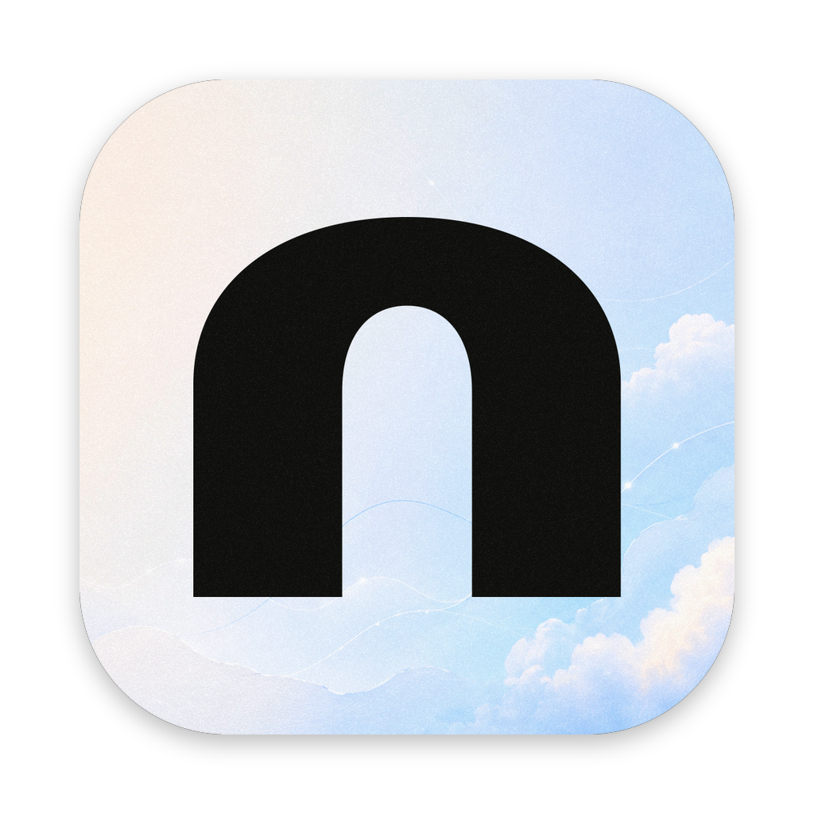

<p align="center">
  
</p>

<h1 align="center">Nod</h1>

> **A local-first meeting notetaker. Your conversations stay on your own devices, encrypted, and sync between them end to end.**

[](LICENSE)
[](apps/relay/LICENSE)
[](REUSE.toml)


Nod records a meeting, transcribes it, and writes the notes, all on your
computer or phone. There is no account and no server that can read your
meetings. Each meeting is encrypted on the device, and your devices share it
through a folder or a relay that only ever sees encrypted files. Audio is
processed in memory and never written to disk.

## ✨ Key features

- **Transcribed on your device.** Parakeet TDT 0.6B v3 or Whisper, running
  locally through whisper.cpp. No audio leaves the machine.
- **Notes written on your device.** Qwen3 4B Instruct writes the summary,
  decisions and action items once a meeting ends.
- **Encrypted at rest.** One encrypted file per meeting, with its key in the
  operating system's keychain.
- **Synced end to end.** Through a folder you already sync, or a relay you can
  run yourself. The vault key is 24 words that you keep.
- **Your phone pairs by QR code.** The iPhone and Android apps record and
  transcribe on the phone, and sync with your computer.
- **Shared on purpose.** Send a meeting's title and summary to one person, or
  to a team with owners, admins, writers and readers. The transcript stays
  with you.
- **Works with your AI assistant.** A read-only MCP server on localhost lets
  assistants search the meetings you allow, with a key per assistant.
- **No telemetry.** No analytics, no crash reports carrying content, no
  account.

## 📚 Contents

- [Status](#-status)
- [Repository layout](#-repository-layout)
- [Prerequisites](#-prerequisites)
- [Building from source](#-building-from-source)
- [Running a sync relay](#-running-a-sync-relay)
- [Privacy and security](#-privacy-and-security)
- [Contributing](#-contributing)
- [License](#-license)

## 🚦 Status

Nod is in active development. There are no published releases yet: to try it,
build it from source as described below. The desktop app runs on macOS,
Windows and Linux; the phone apps are in progress on the same core.

## 🗂 Repository layout

| Path                        | What it is                                                  |
| --------------------------- | ----------------------------------------------------------- |
| `apps/desktop`              | The app for macOS, Windows and Linux (Electron, React)      |
| `apps/mobile`               | The app for iOS and Android (Expo, React Native)            |
| `apps/relay`                | The optional, self-hostable sync relay                      |
| `packages/core`             | The data model, sync and crypto every app shares            |
| `packages/automerge-native` | Automerge on a Rust backend, for phones without WebAssembly |
| `docs/decisions`            | Why things are built the way they are                       |

## 🛠 Prerequisites

- **Node.js 24** or later
- **pnpm 11** (the version in `package.json`)
- **Rust 1.90** through `rustup`: the tests and the phone apps build the native
  Automerge library

For the phone apps, also:

- **iOS:** Xcode
- **Android:** JDK 17 and the Android SDK with its NDK, with `JAVA_HOME` and
  `ANDROID_HOME` set

See [`apps/mobile/README.md`](apps/mobile/README.md) for the details.

## 🏗 Building from source

```sh
git clone <this repository>
cd nod-monorepo
pnpm install

pnpm desktop      # the desktop app in development mode
pnpm make         # desktop installers for this computer's OS, in apps/desktop/out/make
pnpm ios          # the phone app on the iOS simulator
pnpm android      # the phone app on an Android emulator or device
```

Before calling a change done:

```sh
pnpm typecheck && pnpm lint && pnpm test
```

Speech and summary models aren't in the repository. The app downloads them
on first use from a pinned revision, and checks each file's size and SHA-256
before it is used.

## 🔄 Running a sync relay

The relay stores encrypted files for your devices and can't read them. Run
one on your own server:

```sh
pnpm --filter @nod/relay build
PORT=8787 RELAY_DATA=/var/lib/nod-relay node apps/relay/dist/server.js
```

Put it behind HTTPS. [`apps/relay/README.md`](apps/relay/README.md) covers the
reverse proxy, team vaults, limits, and deploying it to Vercel.

## 🔒 Privacy and security

- Audio is processed in memory and never stored.
- Meetings are encrypted on the device with AES-256-GCM. Sync carries only
  encrypted files, which the folder or relay can't open.
- Nothing is sent to a third party unless you turn it on, and the app says
  where it goes.

The design is written down in [`docs/decisions`](docs/decisions): start with
[`0001-sync.md`](docs/decisions/0001-sync.md) and
[`0003-sharing.md`](docs/decisions/0003-sharing.md). Please report a security
problem privately to the maintainer, not in a public issue.

## 🤝 Contributing

Pull requests aren't accepted; issues are welcome. See
[CONTRIBUTING.md](CONTRIBUTING.md) for what to put in one. Rules for working on
the code, for people and coding agents alike, are in [`AGENTS.md`](AGENTS.md)
and [`.agents`](.agents).

## 📄 License

Nod is licensed under the [Apache License 2.0](LICENSE), with one exception:
the sync relay in `apps/relay` is licensed under the
[GNU Affero General Public License v3.0 only](apps/relay/LICENSE). If you run a
modified relay as a service, you must offer its source to the people who use
it.

| Path                        | License       |
| --------------------------- | ------------- |
| `apps/desktop`              | Apache-2.0    |
| `apps/relay`                | AGPL-3.0-only |
| `apps/mobile`               | Apache-2.0    |
| `packages/core`             | Apache-2.0    |
| `packages/automerge-native` | Apache-2.0    |

Folders don't decide a license on their own. [REUSE.toml](REUSE.toml) states
the license of every file, and each relay file carries an SPDX license header
naming AGPL-3.0-only. A built relay combines the relay with `@nod/core`
(Apache-2.0) and is licensed as a whole under the AGPL; its build writes the
banner, the license texts and the third-party notices next to it. License texts
are in [LICENSES](LICENSES). Third-party software that ships inside the apps is
listed with its licenses in each app.

Copyright 2026 Dima Barabash. The name "Nod" and its logo are not covered by
these licenses; see [NOTICE](NOTICE).
